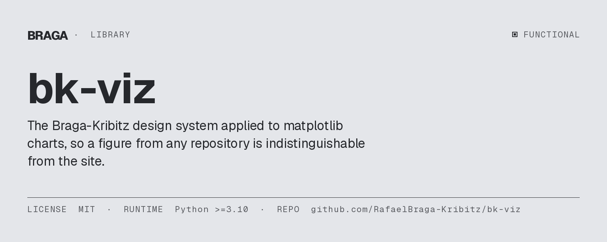
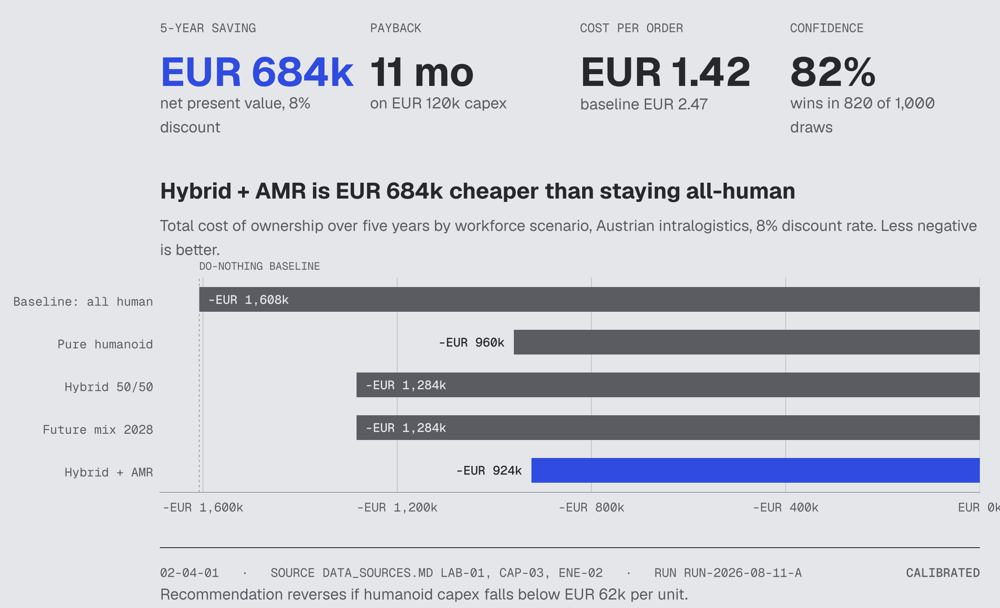

# bk-viz



[](pyproject.toml)
[](LICENSE)
[](#status)

**Status:** Functional

**Problem:** a chart from any repo should be indistinguishable from a chart on
the site; if two charts from different repos do not look like siblings, the
theme is not applied.



*What this image is: the output of `python example_executive_onepager.py` (light mode; `example_dark.png` is the dark render). It shows the theme's decision-panel shape — KPI row, finding title, one highlighted bar, provenance footer. The numbers in it are the script's placeholder DATA block, tagged ILLUSTRATIVE; they are not results from any project. Replace that block with a read from your own metrics artifact.*

## What it does

The Braga design system (v2.1), applied to charts. A chart from any repo should
be indistinguishable from a chart on the site.

Every value comes from the design system of record,
[braga-portfolio-v2 `design-system/tokens.json`](https://github.com/RafaelBraga-Kribitz/braga-portfolio-v2/tree/main/design-system)
(`tokens.css` resolved to plain values). A snapshot ships in `bk_design/`; a
sibling `../braga-portfolio-v2` checkout or `BRAGA_DS` wins, so a token change
there reaches the charts without a release. The chart rules are D-015–D-018,
D-033, D-036 and D-053 in its `DECISIONS.md`. This module is a mirror, not a
second opinion: it carries no hex value of its own, and a test fails when the
snapshot drifts from a design-system checkout.

## Explore this project

| Path | Start here |
| --- | --- |
| Fast path | [Minimum viable chart](#minimum-viable-chart): one call installs the theme, one call builds the executive panel |
| Deep path | [What it enforces](#what-it-enforces) for the rules, then the [API reference](#api-reference) for every public name |

## Install

```bash
uv pip install "git+https://github.com/RafaelBraga-Kribitz/bk-viz@0260404decad55dc9d48646b6748254b776e764d"
```

```toml
dependencies = ["bk-viz @ git+https://github.com/RafaelBraga-Kribitz/bk-viz@0260404decad55dc9d48646b6748254b776e764d"]
```

The pin is the 2.1.0 merge commit; a `v2.1.0` tag on that commit is equivalent once it is pushed.

BKribitz and BKribitz Mono (modified Geist cuts, SIL OFL 1.1) are bundled in
`bk_design/fonts/` and registered by `apply()`; nothing to point at.

## Minimum viable chart

```python
import bk_theme as bk

bk.apply("light")

fig, ax = bk.decision_panel(
    kpis=[
        {"label": "5-year saving", "value": "EUR 684k",
         "note": "net present value, 8% discount", "accent": True},
        {"label": "Payback", "value": "11 mo", "note": "on EUR 120k capex"},
    ],
    finding="Hybrid + AMR is EUR 684k cheaper than staying all-human",
    context="Five-year TCO by workforce scenario, 8% discount rate.",
    left=0.16,
)
ax.barh(labels, values, color=bk.highlight_palette(labels, highlight="Hybrid + AMR"))
bk.strip_chrome(ax, keep=("bottom",))
bk.money_axis(ax, axis="x", unit="k")
bk.value_labels(ax, orient="h", fmt=bk.fmt_eur_k)
bk.footer(fig, number="02-04-01", source="DATA_SOURCES.md LAB-01",
          run_id="run-2026-08-11-a", tag="CALIBRATED", left=0.16)
bk.save(fig, "reports/executive/01_tco_ranking")
```

`python example_executive_onepager.py` renders the full worked example in both
modes.

## What it enforces

| Rule | Where |
| --- | --- |
| Flat opaque surfaces, no gradient, no shadow, no alpha | `apply()` |
| The page surface (`surface`, light `#E4E6EA` / dark `#191A1D`), never white | `apply()`, `save()` |
| Axes in 1px `mid`, gridlines in 1px `rule-c`; an ink rule opens the KPI strip and the footer, nothing closes (D-044) | `apply()`, `strip_chrome()`, `kpi_row()`, `footer()` |
| IBCS is the only notation: `sc-ac`, `sc-py`, `sc-pl`; good variance `var-pos`, bad `var-neg` with ▲ | `c()`, `variance_color()`, `variance_label()` |
| One highlight per chart in `hl` (the ultramarine accent), one accent per KPI strip | `highlight_palette()`, `kpi_row()` warn on more |
| Colour lives in marks, never in type; `mid` is never text | every label helper uses `ink` / `ink-2` |
| Numbers set in BKribitz Mono, tabular with a slashed zero | rcParams default is mono |
| Headings 700, no size below 12px, square corners | `SIZE`, `WEIGHT` |
| Every published figure carries provenance | `footer()` |

## Modes

`bk.apply("light")` or `bk.apply("dark")`. Dark is a property the figure carries,
matching the system's `.dark` semantics; every role and scale has its dark value
in `tokens.json`, which `c()` and `palette()` pick for the current mode.

## Data-vis scales

The seven scales of D-017, by name: `seq` (ultramarine, 9), `div` (good/bad, 13),
`two` (ultramarine ↔ ochre, 13), `long` (8), `short` (8), `categorical` (five hue
slots used in order; a sixth series is `c("cat-other")`) and `categorical-grey`
(parts of a whole).

```python
bk.palette("div", n=5)          # samples evenly across the 13 stops
bk.palette("categorical", n=3)  # ultramarine, ochre, teal
```

### Continuous fills

Heatmaps, contours and choropleths take their scale from `fill_scale` (D-053), so
the choice is the system's, not the chart's:

```python
f = bk.fill_scale(z.min(), z.max())                       # a magnitude: seq, darker for more
f = bk.fill_scale(z.min(), z.max(), midpoint=0.0)         # around a real midpoint: div, centred on it
f = bk.fill_scale(z.min(), z.max(), midpoint=0.0, steps=9)  # stepped: one band per scale step
ax.contourf(x, y, z, levels=f.levels, cmap=f.cmap, norm=f.norm)
```

A one-sided magnitude takes `seq`. A diverging scale (`div`, or `two` when
neither side is good) is used only around a midpoint you name, and is anchored
there, never at the data's own minimum. When every value sits on one side of
that midpoint there is no tie to show, so the fill falls back to `seq`, darker
the farther from it. `steps` above the scale's own count raises: bands sliced
finer than the scale cannot be told apart.

The v1 names (`seq-blue`, `div-warm-cool`, `div-political`, `interp-long`,
`interp-short`, `seq-orange`) still resolve, with a `DeprecationWarning`, to their
v2 replacements; `c("accent-02")` raises, since the moment blue is retired (D-005).

## Non-Python surfaces

`bk.dump_tokens("bk_tokens.json")` exports the chart layer's token view for a
Tableau custom palette or a Power BI theme file. For CSS, read the design
system's own `tokens.json`.

## API reference

Everything in `bk_theme.__all__`. Purposes are the first line of each docstring;
where a function has no docstring, the row states what its code does.

| Name | Purpose |
| --- | --- |
| `TOKENS` | The design-system `tokens.json` this module renders with |
| `DS_VERSION` | Its version (`2.1.0`) |
| `CHART_TOKENS` | The chart layer's view of the tokens; `dump_tokens()` writes it as JSON |
| `COLOR` | Semantic colour roles per mode, IBCS roles and categorical slots included |
| `CHART_PALETTES` | The scales per mode; index 0 is the darkest stop |
| `SCALES` | Scale name → what it is for |
| `EPISTEMIC_TAGS` | Epistemic tags, carried on every published figure via `footer()`; all ink-2 |
| `register_fonts(path=None)` | Register BKribitz and BKribitz Mono and read back their family names |
| `apply(theme="light", *, scale, grid, fonts)` | Install the design system as matplotlib rcParams |
| `mode()` | Current render mode, `"light"` or `"dark"` |
| `c(role)` | Resolve a semantic colour role in the current mode |
| `font(role="display", weight=400, size=None)` | Return `FontProperties` for a role and weight |
| `figsize(cols=12, rows=6)` | Convert a column span into inches using the real 12-column page maths |
| `new_figure(cols=12, rows=6, *, nrows, ncols, **kwargs)` | `plt.subplots` sized on the 12-column grid |
| `decision_panel(*, kpis, finding, context, cols, rows, left, right, bottom)` | The executive one-pager: metric row, finding, chart, provenance strip |
| `highlight_palette(labels, highlight=None, *, base, accent)` | Structure grey for everything, the highlight for the one thing that earned it |
| `neutral_ramp(n)` | `n` structure greys, darkest first (IBCS parts of a whole) |
| `palette(name, n=None, *, reverse=False)` | Return a design-system scale for the current mode |
| `fill_scale(vmin, vmax, *, midpoint, scale, steps)` | Colour map, norm and levels for a continuous fill: `seq` for a magnitude, `div`/`two` anchored at a real midpoint |
| `FillScale` | What `fill_scale` returns: `cmap`, `norm`, `levels` (`None` for a smooth gradient) |
| `tag_color(tag)` | Colour for an epistemic tag |
| `variance_color(delta, *, higher_is_better=True)` | IBCS variance colour: `var-pos` when good, `var-neg` when bad |
| `variance_label(text, delta, *, higher_is_better=True)` | A variance label; a bad variance always carries ▲ |
| `finding_title(ax, finding, context=None)` | Headline states the conclusion; the line under it states the variable |
| `footer(fig, *, source, run_id, tag, note, number, left, right, y)` | Provenance strip: opening rule, source and run, epistemic tag, note |
| `direct_label(ax, x, y, text, *, color, dx, dy, role, weight, size, ha, va)` | Label a series at its endpoint instead of adding a legend entry |
| `value_labels(ax, *, orient="v", fmt, inside_threshold, pad)` | Write each bar's value at its end, in mono so the figures stay tabular |
| `kpi_row(fig, kpis, *, top, height, left, right)` | The metric strip in figure space: opening ink rule, mono label, big figure |
| `strip_chrome(ax, keep=("left", "bottom"), *, ticks=True)` | Keep only the hairlines that carry structure; drop tick marks |
| `reference_line(ax, value, label=None, *, orient="h", color)` | A baseline or threshold, drawn as a hairline and labelled in place |
| `annotate_delta(ax, x, y_from, y_to, text, *, color)` | Bracket the gap between two values and name it; the delta is the decision |
| `check_glyphs(fig, *, raise_on_missing=False)` | Report characters in the figure the registered BKribitz files cannot render |
| `fmt_eur(v)` | No docstring; formats `v` as `EUR 1,234` with the sign in front |
| `fmt_eur_k(v)` | No docstring; formats `v / 1_000` as `EUR 684k` with the sign in front |
| `fmt_eur_m(v, decimals=2)` | No docstring; formats `v / 1_000_000` as `EUR 1.23M` with the sign in front |
| `fmt_pct(v, decimals=1)` | `v` as a fraction: 0.0615 renders as 6.2% |
| `fmt_pp(v, decimals=2)` | Percentage points, always signed |
| `fmt_months(v)` | No docstring; `"11 mo"` for `v >= 1`, otherwise `v * 30` as days |
| `fmt_int(v)` | No docstring; `v` with thousands separators and no decimals |
| `money_axis(ax, axis="y", unit="k", nbins=5)` | Euro formatting on an axis; `nbins` caps ticks, five is usually enough |
| `pct_axis(ax, axis="y", decimals=0, nbins=5)` | No docstring; sets `fmt_pct` as the axis formatter and caps ticks at `nbins` |
| `save(fig, path, *, formats=("png", "svg"), dpi, close, allow_pdf)` | Write the figure once per format; `path` is given without an extension; PDF is allowed (OFL) |
| `dump_tokens(path="bk_tokens.json")` | Export the chart token view as JSON |
| `plotly_template(register_as="bk", set_default=True)` | Build and register the equivalent plotly template; requires plotly |

## Acceptance test

If two charts from different repos do not look like siblings, the theme is not
applied. `pytest` checks the module against the design system: no hex literal in
`bk_theme.py`, the snapshot equal to a sibling `tokens.json`, every role resolved
in both modes, one-highlight and ▲ rules.

## Limitations

- **Number formats are English.** `fmt_*` write `EUR 1,234` and `6.2%`; the
  site's German formats (D-031) are not implemented here.
- **SVG references the face by name** (`svg.fonttype: none`), so an SVG opened
  where BKribitz is not installed renders in a fallback; PNG and PDF carry it.
- **Upgrading from 1.x changes every chart.** Ultramarine replaces the orange,
  BKribitz replaces Söhne, scales are renamed (aliases warn); re-render committed
  figures after upgrading.

## Stack

| Technology | Why it is here |
| --- | --- |
| Python 3.10+ | `requires-python = ">=3.10"` in `pyproject.toml` |
| matplotlib >= 3.7 | The theme is installed as matplotlib rcParams by `apply()` |
| fonttools >= 4.40 | `check_glyphs()` reads the registered font files' character map to name the missing glyphs |
| pytest (optional, `[test]` extra) | `tests/` checks the module against the design system |
| plotly >= 5.18 (optional, `[plotly]` extra) | `plotly_template()` builds and registers the equivalent plotly template |

## Repository structure

| Path | Role |
| --- | --- |
| `bk_theme.py` | The module: the Braga design system v2.1 applied to charts, read from `tokens.json` |
| `bk_design/` | The snapshot of braga-portfolio-v2 `design-system/tokens.json` and the BKribitz faces as TTF (SIL OFL 1.1, licence and notice alongside); packaged with the module |
| `tests/` | The module checked against the design system |
| `bk_tokens.json` | The chart token view as JSON, the output of `dump_tokens()`, for a Tableau palette or a Power BI theme file |
| `example_executive_onepager.py` | Worked example: the executive decision panel, rendered in both light and dark |
| `example_light.png` | The worked example in light mode (the hero image above) |
| `example_dark.png` | The worked example in dark mode |
| `pyproject.toml` | Package metadata, dependencies and the hatchling build (the wheel includes `bk_theme.py` and `bk_design/`) |
| `README.md` | This file |
| `LICENSE` | MIT |

## Status

**Status:** Functional

Version 2.1.0, on design system v2.1 (27 Oct 2026): adds `fill_scale` for continuous fills.

## License

MIT. See [`LICENSE`](LICENSE).

## Author

<table>
  <tr>
    <td width="110">
      
    </td>
    <td>
      <strong>Rafael Braga-Kribitz</strong><br />
      Seiersberg-Pirka, Austria · Portfolio project, 2026<br />
      <a href="https://www.linkedin.com/in/rafaelbragakribitz/">LinkedIn</a>
      ·
      <a href="mailto:rafaelbragakribitz@gmail.com">rafaelbragakribitz@gmail.com</a>
    </td>
  </tr>
</table>
